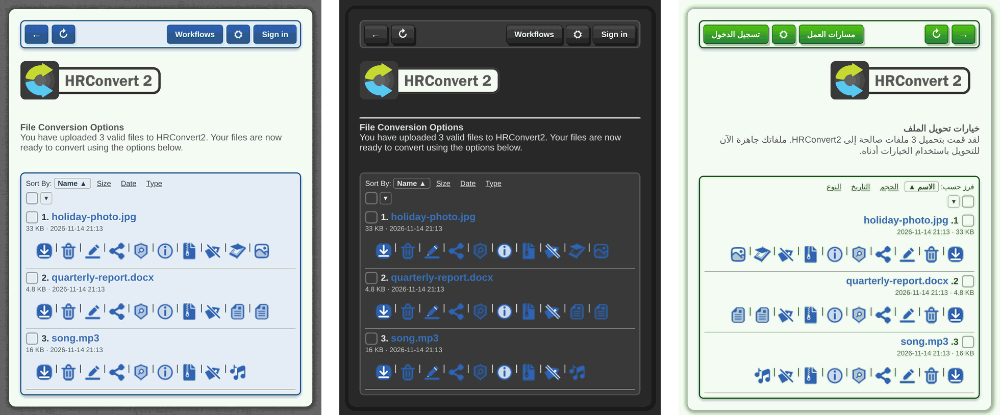
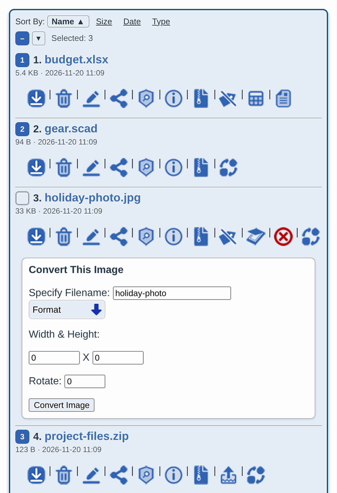
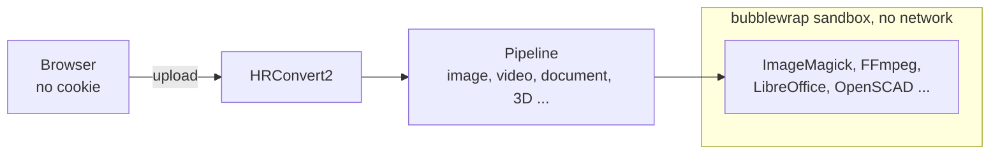
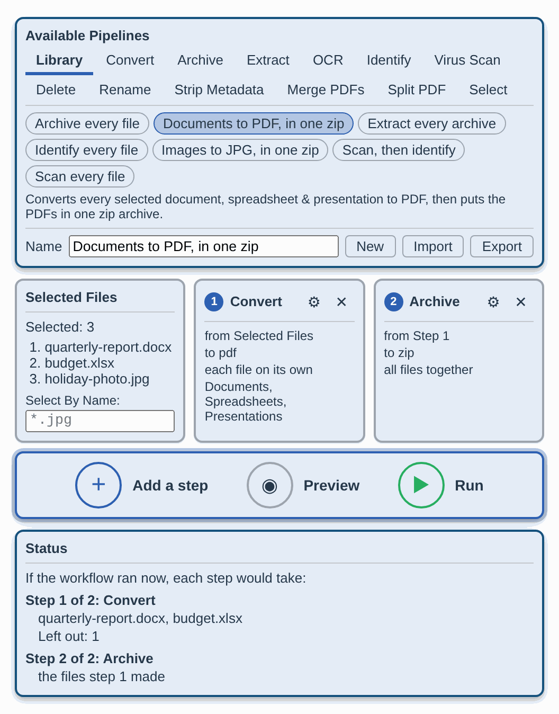
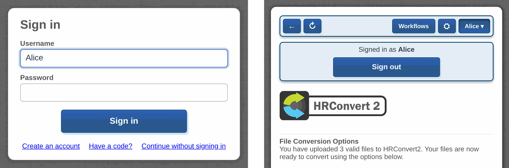
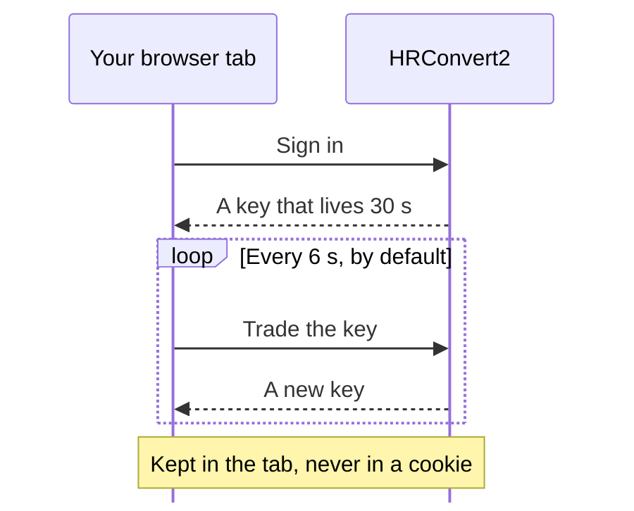

<p align="center">
  
</p>

<p align="center">
  <strong>Convert almost anything, on your own server. Nothing ever leaves it.</strong><br>
  A self-hosted file converter for the public internet, with every converter locked in a sandbox.
</p>

<p align="center">
  <strong>490+ formats</strong> · <strong>26 languages</strong> · <strong>runs on a Raspberry Pi</strong><br>
  <strong><a href="#-workflows-that-save-the-clicking">multi-step workflows</a></strong> · <strong><a href="#-optional-accounts-still-no-cookies">optional accounts</a></strong> · <strong>no cookies, database or tracking</strong>
</p>

<p align="center">
  <a href="#-quick-start"><strong>Get Started</strong></a> ·
  <a href="https://hub.docker.com/r/zelon88/hrconvert2">Docker Image</a> ·
  <a href="Documentation">Documentation</a> ·
  <a href="Documentation/SECURITY.md">Security Policy</a>
</p>

<p align="center">
  
  <br><sub>Seven colour schemes, two interfaces and 26 languages, with right-to-left layouts where a language needs one.</sub>
</p>

---

## 🔒 Why HRConvert2?

Free online converters are paid for with your files. Upload a contract, a medical scan or a client's CAD drawing and it now sits on a stranger's server, next to an ad network.

**HRConvert2 gives you the same convenience with none of that.** Drag a file in, pick a format, download the result. The conversion happens on hardware you control, your visitors need no account, and their files are deleted on a schedule you set.

| Promise | What it means |
| :--- | :--- |
| 🏠 **Nothing transmitted** | Every conversion runs on your server, with local tools. No CDN, no analytics, no telemetry. |
| 👤 **No cookies, no account needed** | Visitors are anonymous, and each gets an isolated folder nobody else can see. Optional accounts, off by default, let a user keep files of their own, still without a cookie. |
| 🗑️ **Files expire** | Uploads and results are deleted automatically after an age you choose, unless a signed-in user keeps them. |
| 🧱 **Sandboxed converters** | Every tool that parses an upload runs in a bubblewrap sandbox with no network. |
| 🌍 **Built for strangers** | Designed to be put on the public internet and attacked, and documented that way. |

---

## ✨ How It Works

<table>
<tr>
<td width="42%" valign="top">
  
</td>
<td valign="top">

1. **Drop files in.** Any number, any mix of types. Archives, photos, documents, 3D models, video.
2. **Choose what to do with each one.** Convert, compress, extract, run OCR, identify, virus scan, strip metadata, merge or split PDFs, rename, share or delete. Only the options that make sense for that file, and that your server has the tools for, appear.
3. **Do it to many at once.** Tick several files to convert or archive them together, or hand them to a **[workflow](#-workflows-that-save-the-clicking)** that runs several steps in a row.
4. **Download the result and walk away.** Files expire on their own, unless you signed in to keep them.

</td>
</tr>
</table>

Every conversion travels the same path:



The result comes back the same way, and expires on the schedule you set.

---

## 🔗 Workflows That Save the Clicking

A **workflow** is a list of steps, each one something you could already do with a button. *Convert every document to PDF, then put the PDFs in one zip* is a workflow of two steps. Start it once and it does every step. Each step runs the same code as its button, under the same limits, so a workflow can do nothing a visitor could not already do by hand.

<p align="center">
  
</p>

- **📚 Start from the library.** Seven ship with HRConvert2, from *Scan every file* to *Documents to PDF, in one zip*. An administrator stages their own for every user from the page, with a description in each language, and root installs it with one command.
- **🗂️ Build your own, no code.** Add a step for any operation, from Convert to Delete. Each step takes the files you ticked or what an earlier step made, filtered by kind, name, extension or size.
- **👀 Preview before it runs.** See which files each step would take. A workflow that deletes files names them and asks first.
- **🏃 Let it run.** Each workflow gets a background process of its own, so no web request's time limit cuts it short. A status panel shows the step, the file and the progress. Stop ends the run before its next step, and reloading the page picks it up again.
- **📤 Share it as a file.** Export a workflow to a small JSON file and import it on any HRConvert2 server that allows importing and has the operations it uses. It carries the steps, never your files, sessions or paths.
- **✅ Yours to limit.** The server checks every workflow, whoever built it, before its first step. You cap the steps, the files, the runtime and how many run at the same time, or switch the builder off.

<details>
<summary><strong>What a workflow file looks like</strong></summary>

```json
{
  "Format": "HRProprietary Workflow",
  "Version": 1,
  "Name": "Documents to PDF, in one zip",
  "Description": "Converts every selected document, spreadsheet & presentation to PDF, then puts the PDFs in one zip archive.",
  "Steps": [
    { "Operation": "Convert",
      "Filter": { "Types": ["Document", "Spreadsheet", "Presentation"] },
      "Options": { "Extension": "pdf" } },
    { "Operation": "Archive", "Mode": "together",
      "Options": { "Extension": "zip", "Filename": "Documents" } }
  ]
}
```

</details>

See [ABOUT_WORKFLOWS](Documentation/ABOUT_WORKFLOWS.txt) for the format, the libraries and every limit.

---

## 👤 Optional Accounts, Still No Cookies

Accounts are **off by default**, and an installation that leaves them off works exactly as it always has. Turn them on and your users can sign in and keep their files between visits.

<p align="center">
  
</p>

- **🍪 No cookie, ever.** A signed-in page keeps a short-lived key in its own memory and the tab's `window.name`, never in a cookie, site storage, a URL or a log. The page trades it for a new one every few seconds. A stolen copy soon expires, and since each key can be traded only once, trading it signs out both the thief and the user. Close the tab and you are signed out.
- **🗄️ No database.** Accounts are files outside the web root, named by hashes, so a listing shows no username or email address. Passwords are hashed with Argon2id where PHP has it, and only a hash of each key is kept.
- **📁 Files that stay.** A signed-in user's uploads go to a private folder that automatic expiry never touches, up to a quota you set. A workflow they start works on their files.
- **🚦 Guessing goes nowhere.** Failed attempts are limited for each network address and each account. A wrong username is refused exactly like a wrong password, and takes just as long.
- **📧 Codes, not links.** Confirming an email address and recovering a password use a short emailed code, handed to your server's own mail system. HRConvert2 connects to no mail service itself. No mail system? Make accounts and reset passwords from the terminal.
- **🚪 You decide who comes in.** Turned on, anyone may register, and anonymous visitors work as before. Close registration and make every account yourself, or require everyone to sign in.



Serve HRConvert2 over HTTPS, then turn accounts on with `sudo php convertCore.php --config`, under **Enable Authentication**. [ABOUT_AUTHENTICATION](Documentation/ABOUT_AUTHENTICATION.txt) says what accounts defend against, and what they do not.

---

## ⚡ Quick Start

### 🧩 Install on Debian or Ubuntu
```bash
sudo git clone https://github.com/zelon88/HRConvert2 /opt/HRConvert2
sudo bash /opt/HRConvert2/Documentation/Build/hrconvert2-setup.sh
```

Two commands. Clone where only root can change it, such as `/opt`, because root will not install a tree another account could change. The installer pulls every dependency, creates the storage, sets up the AppArmor profile, PHP and the systemd units, installs HRConvert2 beside its storage, outside the web root, puts in the web root only what a browser needs, then tells you exactly what is working. Add `-y` to skip the confirmations.

Then open `http://your-server/HRProprietary/HRConvert2/convertCore.php` and start converting.

### 🐳 Docker
```bash
docker run -d -p 8080:80 --cap-add SYS_ADMIN -v hrconvert2-data:/DATA/HRConvert2 zelon88/hrconvert2
```

`SYS_ADMIN` lets the container build the sandbox every converter runs in. Leave it off and the container cannot build one. No process that converts or serves a user's file holds `SYS_ADMIN`, or any other capability. Run `php convertCore.php -v` inside the container to confirm the sandbox works. The named volume keeps sessions, accounts and their files when you replace the container to update, and [DOCKER_BUILD_INSTRUCTIONS](Documentation/DOCKER_BUILD_INSTRUCTIONS.txt) lists what else to keep, such as your settings.

### 🩺 When Something Is Wrong
```bash
cd /var/www/html/HRProprietary/HRConvert2
sudo php convertCore.php -v     # Check every component & say what is wrong
sudo php convertCore.php -fp    # Repair permissions & the web server setup
```

---

## 📦 490+ Formats

| Category | Examples |
| :--- | :--- |
| **Documents** | doc, docx, odt, rtf, txt, pdf |
| **Spreadsheets** | xls, xlsx, ods, csv |
| **Presentations** | ppt, pptx, odp |
| **Images** | jpg, png, gif, webp, heic, avif, svg, ico, tiff |
| **Video** | mp4, mkv, avi, mov, webm, flv, and 50+ more |
| **Audio** | mp3, flac, aac, wav, opus, wma, and 30+ more |
| **Subtitles** | srt, vtt, ass, sub, sbv, ttml, and more |
| **E-Books** | epub, mobi, azw, azw3, azw4 |
| **Archives** | zip, rar, 7z, tar, gz, bz2 |
| **Extract** | Every file an archive holds, placed beside it, within the size & count limits you set |
| **3D Models** | obj, stl, ply, collada, and OpenSCAD sources |
| **Drawings & Vectors** | dxf, dia, vdx, svg |
| **Bootable Disk Images** | x86, ARM, UEFI and MBR/GPT hybrid ISOs |
| **OCR** | Extract text from images and PDFs |
| **Identify** | Size, type, character set & hashes of any file, and whether its name matches what it holds |
| **Strip Metadata** | A copy of a photo, PDF, office document, ebook, song or video without its authors, places, dates or the software that made it |
| **Merge & Split PDFs** | Put several PDFs into one, or make a PDF of each page |
| **Rename & Delete** | Rename one file or every selected file from a pattern, keeping each extension, or delete a selection |
| **Workflows** | Any of the above, chained into one run. See [Workflows](#-workflows-that-save-the-clicking). |
| **Live Streams** | Capture and convert m3u8 playlists |
| **Remote Files** | Fetch a file from a URL. Off by default. |

---

## 🛡️ Security You Can Read

HRConvert2 assumes every tool that parses a hostile file can be exploited. So the sandbox is the security boundary, and everything else is a layer on top of it.

- **🧱 Sandboxed converters.** ImageMagick, FFmpeg, LibreOffice, Inkscape, OpenSCAD and every other converter run inside bubblewrap. Each sees only its own input and output, with no network at all.
- **🧼 Hostile inputs disarmed.** OpenSCAD sources are rewritten before they render. Archives are listed before they are opened & measured while they are extracted, & their links are pruned before they reach anything. Stream URLs are inspected before FFmpeg sees them. Fetched files are checked before they are placed.
- **📋 An audited supply chain.** Every dependency is declared in one manifest with minimum and maximum versions. Every pipeline carries an approval record for the dependencies it uses, and approvals expire every year.
- **🏆 Reports are welcome and credited.** Every advisory is accepted, and every reporter is credited publicly once the fix ships. Two were credited in v4.0.0. See the [Security Policy](Documentation/SECURITY.md).
- **🔍 Checked by machine as well as by hand.** Two independent linters, in Python and Bash, check every change, and each check is proven against faults planted on purpose. Every error the application can raise is documented with its cause and its fix.
- **🔑 No guessable secrets.** Sessions derive from a per-install secret, and updates need shell access.
- **🔐 Accounts that resist theft.** The accounts folder holds only hashes of passwords and keys, so a stolen copy signs nobody in. Over HTTPS, in any current browser, no other site can plant a key in a tab or read one from it.

---

## 🌐 26 Languages

Visitors switch language from the page. Nothing to install.

<p align="center">
English · Français · Español · 中文 · हिन्दी · العربية · Русский · Українська · বাংলা<br>
Deutsch · 한국어 · Italiano · Português · Tiếng Việt · Türkçe · 日本語 · Bahasa Indonesia<br>
Polski · Nederlands · Kiswahili · မြန်မာ · اردو · فارسی · עברית · ܣܘܪܝܝܐ · ܐܪܡܝܐ
</p>

Arabic, Hebrew, Persian, Urdu and both Syriac script languages get proper right-to-left layouts. A new language is one folder, with no change to the core.

---

## 🚀 Built for Administrators

- **🧩 Built on the HRProprietary Engine.** HRConvert2 is a thin application on a reusable engine. The engine provides sandboxing, dependency management, self-repairing configuration, resource budgets, workflows, accounts and data protection. Every conversion, scan and file operation is a version-pinned **pipeline** you can inspect with `--pipeline`.
- **🔎 Honest about your server.** Each pipeline declares the tools it cannot run without, and a page offers only what your server has the tools for. `-v` names every pipeline it cannot offer, and what it is missing.
- **⚙️ Resource-aware.** Optional processor and memory budgets keep a busy server responsive, and runaway conversions are stopped. Storage can span several disks, round-robin, least-active or as a standby, and work stops before any of them fills. A missing budget never stops a conversion.
- **🔄 Updates that roll back.** `php convertCore.php -u` stages a release, swaps it in, and validates it. If the new version can't run, it rolls back on its own. Your configuration is kept. It's off until you turn on `--Enable Automatic Updates--`.
- **🎨 Yours to brand.** Each interface and each language is a folder. Fork one, restyle it, and lock your visitors' choices in `config.php`.

Everything is manageable from the terminal, as root:

```bash
php convertCore.php -v                              # Check every component, dependency & feature
php convertCore.php --status                        # System state & the listener
php convertCore.php --config                        # Interactive configuration
php convertCore.php --config --repair               # Add any setting the configuration is missing
php convertCore.php --setup --check-depends         # Audit every dependency
php convertCore.php --pipeline --verify             # Confirm every pipeline loaded
php convertCore.php --workflow --list               # List workflows, & why any is not offered
php convertCore.php --workflow --install=FILE       # Check a workflow & offer it to every user
php convertCore.php --workflow --install-staged=ID  # Install a workflow an admin staged from the page
php convertCore.php --workflow --discard-staged=ID  # Turn a staged workflow down & install nothing
php convertCore.php --workflow --export=ID          # Print a workflow as a file a page can import
php convertCore.php --account --list                # List accounts, roles & last sign-ins
php convertCore.php --account --add NAME EMAIL      # Make an account & show its password once
php convertCore.php --account --password NAME       # Give an account a new password & show it once
php convertCore.php -u=latest                       # Update to the newest release, once updates are on
php convertCore.php -c                              # Clean every expired session now
```

Every command exits with a status a script can act on. See the [full command reference](Documentation/ABOUT_COMMAND_LINE_ARGUMENTS.txt).

---

## 🧾 Requirements

| | Minimum |
| :--- | :--- |
| **OS** | Debian or Ubuntu Linux |
| **Web server** | Apache 2.4 |
| **PHP** | 8.0 or later |
| **Hardware** | Raspberry Pi Model B+. Any x86 or x64 machine is comfortable. |
| **Sandbox** | Bubblewrap |
| **Email** | Optional. A local mail system, for confirming email addresses and recovering passwords. HRConvert2 installs none. |

The installer handles every dependency. The authoritative list is [depends.php](Resources/Contract/depends.php).

---

## 🤝 Contributing

- **🌍 Translations.** Add a folder.
- **🎨 Interfaces.** Fork a UI folder and make it yours.
- **🔗 Workflows.** Export one you are proud of and share the file.
- **🐛 Bug reports.** Include the steps that reproduce it and the output of `php convertCore.php -v`.
- **🔐 Security reports.** Report them privately from the **Security** tab, never in an issue. Every report is accepted, and every reporter is credited once the fix ships. See the [Security Policy](Documentation/SECURITY.md).

---

## 📜 License

[GNU General Public License v3.0](Documentation/LICENSE). Free to use, free to modify, free to self-host. If you improve it, send it back.

<p align="center">
  <sub>Built by <a href="https://github.com/zelon88">@zelon88</a> for people who would rather not hand their files to strangers.</sub>
</p>
