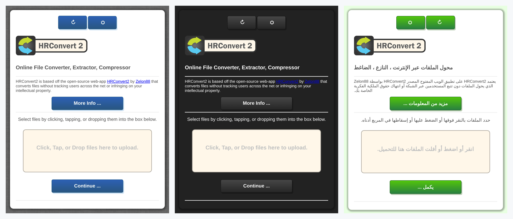
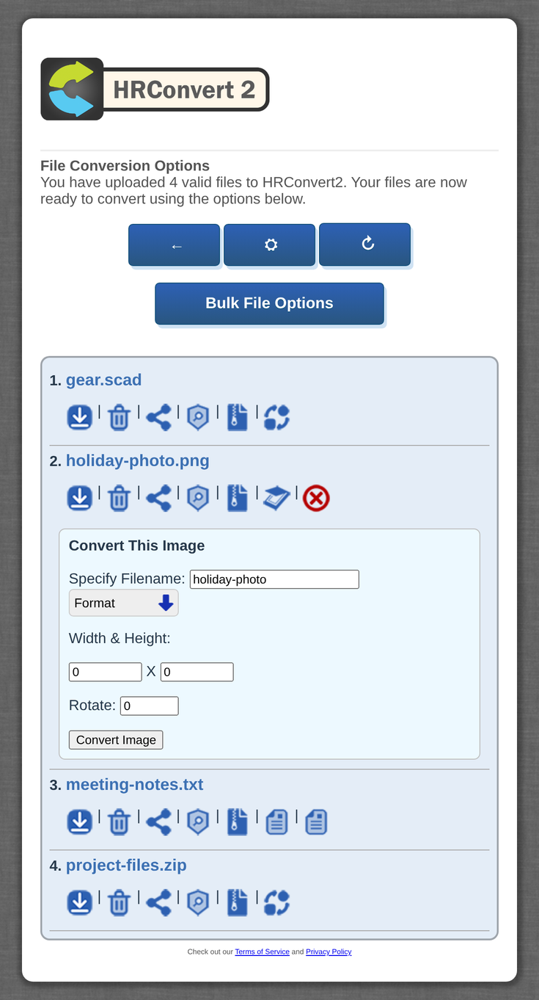
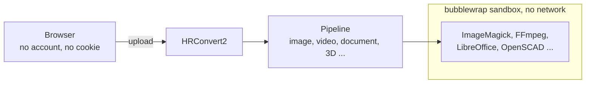
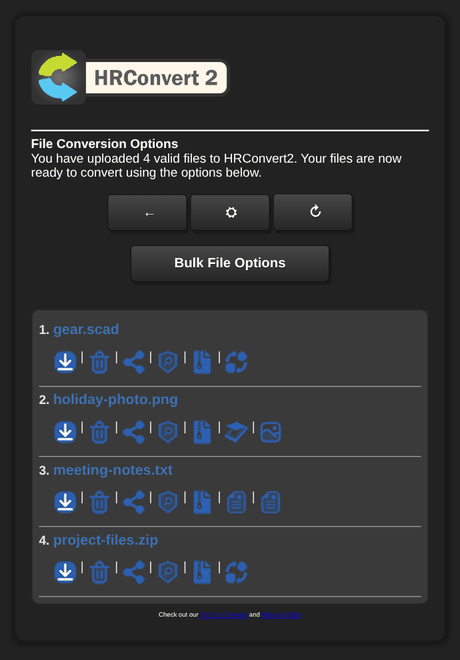

<p align="center">
  
</p>

<p align="center">
  <strong>Convert almost anything, on your own server. Nothing ever leaves it.</strong><br>
  A self-hosted file converter for the public internet, with every converter locked in a sandbox.
</p>

<p align="center">
  <strong>490+ formats</strong> · <strong>26 languages</strong> · <strong>runs on a Raspberry Pi</strong> · <strong>no accounts, cookies, database or tracking</strong>
</p>

<p align="center">
  <a href="#-quick-start"><strong>Get Started</strong></a> ·
  <a href="https://hub.docker.com/r/zelon88/hrconvert2">Docker Image</a> ·
  <a href="Documentation">Documentation</a> ·
  <a href="Documentation/SECURITY.md">Security Policy</a>
</p>

<p align="center">
  
  <br><sub>Seven colour schemes, two interfaces and 26 languages, with right-to-left layouts where a language needs one.</sub>
</p>

---

## 🔒 Why HRConvert2?

Free online converters are paid for with your files. Upload a contract, a medical scan or a client's CAD drawing and it now sits on a stranger's server, next to an ad network.

**HRConvert2 gives you the same convenience with none of that.** Drag a file in, pick a format, download the result. The conversion happens on hardware you control, your visitors never make an account, and their files are deleted on a schedule you set.

| Promise | What it means |
| :--- | :--- |
| 🏠 **Nothing transmitted** | Every conversion runs on your server, with local tools. No CDN, no analytics, no telemetry. |
| 👤 **No accounts, no cookies** | Visitors are anonymous. Each gets an isolated folder nobody else can see. |
| 🗑️ **Files expire** | Uploads and results are deleted automatically after an age you choose. |
| 🧱 **Sandboxed converters** | Every tool that parses an upload runs in a bubblewrap sandbox with no network. |
| 🌍 **Built for strangers** | Designed to be put on the public internet and attacked, and documented that way. |

---

## ✨ How It Works

<table>
<tr>
<td width="42%" valign="top">
  
</td>
<td valign="top">

1. **Drop files in.** Any number, any mix of types. Archives, photos, documents, 3D models, video.
2. **Choose what to do with each one.** Convert, compress, extract, run OCR, identify, virus scan, share or delete. Only the options that make sense for that file appear.
3. **Download the result.** Tick several files to convert or archive them all at once, or run or build a **workflow** that chains steps, such as every document to PDF and then one zip.
4. **Walk away.** Files expire on their own and nothing about the visit is kept.

</td>
</tr>
</table>

Every conversion travels the same path:



The result comes back the same way, and expires on the schedule you set.

---

## ⚡ Quick Start

### 🧩 Install on Debian or Ubuntu
```bash
sudo git clone https://github.com/zelon88/HRConvert2 /opt/HRConvert2
sudo bash /opt/HRConvert2/Documentation/Build/hrconvert2-setup.sh
```

Two commands. Clone where only root can change it, such as `/opt`, because root will not install a tree another account could change. The installer pulls every dependency, creates the storage, sets up the AppArmor profile, PHP and the systemd units, installs HRConvert2 beside its storage, outside the web root, then tells you exactly what is working. Add `-y` to skip the confirmations.

Then open `http://your-server/HRProprietary/HRConvert2/convertCore.php` and start converting.

### 🐳 Docker
```bash
docker run -d -p 8080:80 --cap-add SYS_ADMIN zelon88/hrconvert2
```

`SYS_ADMIN` lets the container build the sandbox every converter runs in. Leave it off and the container cannot build one. No process that converts or serves a user's file holds `SYS_ADMIN`, or any other capability. Run `php convertCore.php -v` inside the container to confirm the sandbox works.

### 🩺 When Something Is Wrong
```bash
cd /var/www/html/HRProprietary/HRConvert2
sudo php convertCore.php -v     # Check every component & say what is wrong
sudo php convertCore.php -fp    # Repair permissions & the web server setup
```

---

## 📦 490+ Formats

| Category | Examples |
| :--- | :--- |
| **Documents** | doc, docx, odt, rtf, txt, pdf |
| **Spreadsheets** | xls, xlsx, ods, csv |
| **Presentations** | ppt, pptx, odp |
| **Images** | jpg, png, gif, webp, heic, avif, svg, ico, tiff |
| **Video** | mp4, mkv, avi, mov, webm, flv, and 50+ more |
| **Audio** | mp3, flac, aac, wav, opus, wma, and 30+ more |
| **Subtitles** | srt, vtt, ass, sub, sbv, ttml, and more |
| **E-Books** | epub, mobi, azw, azw3, azw4 |
| **Archives** | zip, rar, 7z, tar, gz, bz2 |
| **Extract** | Every file an archive holds, placed beside it, within the size & count limits you set |
| **3D Models** | obj, stl, ply, collada, and OpenSCAD sources |
| **Drawings & Vectors** | dxf, dia, vdx, svg |
| **Bootable Disk Images** | x86, ARM, UEFI and MBR/GPT hybrid ISOs |
| **OCR** | Extract text from images and PDFs |
| **Identify** | Size, type, character set & hashes of any file, and whether its name matches what it holds |
| **Workflows** | Choose or build a chain of conversions, archives, extractions, OCR, scans & identification, export & import it, and watch it run in the background |
| **Live Streams** | Capture and convert m3u8 playlists |
| **Remote Files** | Fetch a file from a URL. Off by default. |

---

## 🛡️ Security You Can Read

HRConvert2 assumes every tool that parses a hostile file can be exploited. So the sandbox is the security boundary, and everything else is a layer on top of it.

- **🧱 Sandboxed converters.** ImageMagick, FFmpeg, LibreOffice, Inkscape, OpenSCAD and every other converter run inside bubblewrap. Each sees only its own input and output, with no network at all.
- **🧼 Hostile inputs disarmed.** OpenSCAD sources are rewritten before they render. Archives are listed before they are opened & measured while they are extracted, & their links are pruned before they reach anything. Stream URLs are inspected before FFmpeg sees them. Fetched files are checked before they are placed.
- **📋 An audited supply chain.** Every dependency is declared in one manifest with minimum and maximum versions. Every pipeline carries an approval record for the dependencies it uses, and approvals expire every year.
- **🏆 Reports are welcome and credited.** Every advisory is accepted, and every reporter is credited publicly once the fix ships. Two were credited in v4.0.0. See the [Security Policy](Documentation/SECURITY.md).
- **🔍 Checked by machine as well as by hand.** Two independent linters, in Python and Bash, check every change, and each check is proven against faults planted on purpose. Every error the application can raise is documented with its cause and its fix.
- **🔑 No guessable secrets.** Sessions derive from a per-install secret, and updates need shell access.

---

## 🌐 26 Languages

Visitors switch language from the page. Nothing to install.

<p align="center">
English · Français · Español · 中文 · हिन्दी · العربية · Русский · Українська · বাংলা<br>
Deutsch · 한국어 · Italiano · Português · Tiếng Việt · Türkçe · 日本語 · Bahasa Indonesia<br>
Polski · Nederlands · Kiswahili · မြန်မာ · اردو · فارسی · עברית · ܣܘܪܝܝܐ · ܐܪܡܝܐ
</p>

Arabic, Hebrew, Persian, Urdu and both Syriac script languages get proper right-to-left layouts. A new language is one folder, with no change to the core.

---

## 🚀 Built for Administrators

<table>
<tr>
<td width="62%" valign="top">

**🧩 Built on the HRProprietary Engine.** HRConvert2 is a thin application on a reusable engine. The engine provides sandboxing, dependency management, self-repairing configuration, resource budgets and data protection. Every conversion, scan and file operation is a version-pinned **pipeline** you can inspect with `--pipeline`.

**⚙️ Resource-aware.** Optional processor and memory budgets keep a busy server responsive, and runaway conversions are stopped. Storage can span several disks, round-robin, least-active or as a standby, and work stops before any of them fills. A missing budget never stops a conversion.

**🔄 Updates that roll back.** `php convertCore.php -u` stages a release, swaps it in, and validates it. If the new version can't run, it rolls back on its own. Your configuration is kept.

**🎨 Yours to brand.** Each interface and each language is a folder. Fork one, restyle it, and lock your visitors' choices in `config.php`.

</td>
<td valign="top">
  
  <br><sub>Every layout fits the device, up to a width you set.</sub>
</td>
</tr>
</table>

Everything is manageable from the terminal:

```bash
php convertCore.php -v                        # Check every component, dependency & feature
php convertCore.php --status                  # System state & the listener
php convertCore.php --config                  # Interactive configuration
php convertCore.php --config --repair         # Add any setting the configuration is missing
php convertCore.php --setup --check-depends   # Audit every dependency
php convertCore.php --pipeline --verify       # Confirm every pipeline loaded
php convertCore.php --workflow --list         # List the workflows users can run, & why one is not offered
php convertCore.php --workflow --export=ID    # Print a workflow as a file a page can import
php convertCore.php -u=latest                 # Update to the newest release
php convertCore.php -c=now                    # Clean every expired session now
```

Every command exits with a status a script can act on. See the [full command reference](Documentation/ABOUT_COMMAND_LINE_ARGUMENTS.txt).

---

## 🧾 Requirements

| | Minimum |
| :--- | :--- |
| **OS** | Debian or Ubuntu Linux |
| **Web server** | Apache 2.4 |
| **PHP** | 8.0 or later |
| **Hardware** | Raspberry Pi Model B+. Any x86 or x64 machine is comfortable. |
| **Sandbox** | Bubblewrap |

The installer handles every dependency. The authoritative list is [depends.php](Resources/Contract/depends.php).

---

## 🤝 Contributing

- **🌍 Translations.** Add a folder.
- **🎨 Interfaces.** Fork a UI folder and make it yours.
- **🐛 Bug reports.** Include the steps that reproduce it and the output of `php convertCore.php -v`.
- **🔐 Security reports.** Report them privately from the **Security** tab, never in an issue. Every report is accepted, and every reporter is credited once the fix ships. See the [Security Policy](Documentation/SECURITY.md).

---

## 📜 License

[GNU General Public License v3.0](Documentation/LICENSE). Free to use, free to modify, free to self-host. If you improve it, send it back.

<p align="center">
  <sub>Built by <a href="https://github.com/zelon88">@zelon88</a> for people who would rather not hand their files to strangers.</sub>
</p>
